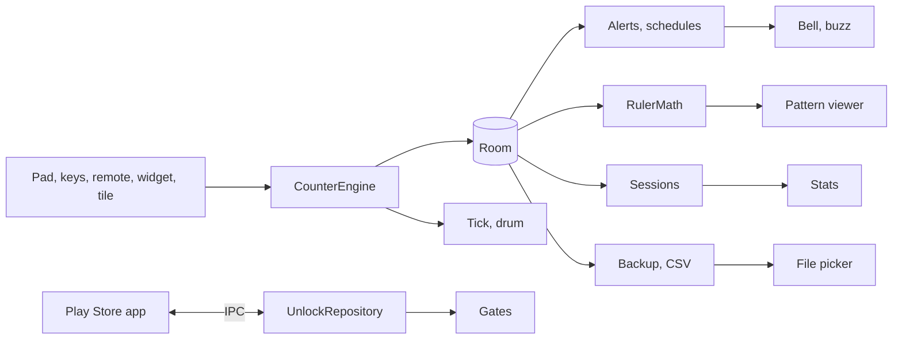

# Rowmark: count rows with the yarn still in your hands

Two needles, a strand over one finger, a cable cross due on row 6, and a phone that wants a clean fingertip. The popular counters answer with ad bursts, a monthly fee or a tap that lands late. In Rowmark, rows roll into repeats and sections by themselves, a volume key or a cheap shutter remote counts, a tick confirms it and a bell rings when the repeat comes round: free, unlimited, offline. One optional purchase adds what pattern followers pay for: the pattern on screen with a moving row ruler, shaping schedules, a time log and a stash.

## 1. Overview

- **Pitch:** linked row counters, volume key and remote counting and repeat alerts, free with no ads; one unlock adds pattern tracking depth.
- **Model:** Free to download, with one optional one-time unlock (Google Play Billing, product `full_unlock`, purchase option `full-unlock-buy`). No ads, no subscription, no account, no INTERNET permission.
- **Unlock price:** USD 2.99, INR 99 (hand-set, tax-inclusive).
- **Category:** Lifestyle. **Name:** Rowmark. **Play title:** Knitting Row Counter: Crochet.
- **Tagline:** Count rows with the yarn still in your hands.
- **Positioning:** The clean, offline row counter for crafters tired of ads between rows and fees every month.

## 2. Problem and why now

Both hands hold work, and a tap puts the work down every row. Demand is proven: on 2026-10-02 **My Row Counter** had 1M+ installs and 4.80 from 15,543 ratings (https://play.google.com/store/apps/details?id=com.row_counter), and seven unrated 2026 newcomers rank 3 to 12 for "knitting row counter", so a new listing reaches page 1 (https://play.google.com/store/search?q=knitting%20row%20counter&c=apps).

The wedge, from the rivals' own reviews (live check, 2026-10-02):
- **My Row Counter:** ads users call close to unusable; battery drain; "can't afford the Premium" ($1.99 to $3.99 a month, $6.99 to $9.99 a year); stats capped at 4 months.
- **Crochet row counter & patterns** (500K+, 4.51, no ads): taps that take minutes to register, paid PDFs lost after a login, no dark mode (https://play.google.com/store/apps/details?id=lv.crochet.app).
- **Easy Knitty** (100K+, 3.06): ads, "almost all features behind a paywall", no backup (https://play.google.com/store/apps/details?id=fr.whatsup_design.easyknitcounter).
- Smaller rivals: an account whose emails fail, nags that lock new projects, a reviewer who "would rather pay to remove the ads" (section 16).

Rowmark answers each: instant taps, no ads, no account, dark mode, unlimited linked counters, a backup file. Hands-off counting is never claimed as unique (the leader has voice, three small apps volume keys); the claim is the clean whole.

**Why 1 to 3 percent buy.** The unlock research expects 1 to 3 percent of utility installs to buy within a month, against a Play freemium median of 0.9 percent (https://www.revenuecat.com/state-of-subscription-apps). Pattern followers already pay rivals for this depth: lv.crochet sells PDF storage, RowNest a chart ruler at $9.99.

## 3. Target audience and personas

- **Maggie Okafor, 41, school librarian, Columbus, Ohio.** Cables at night; types "knitting row counter". Stays for the shutter remote; buys when her third PDF pattern arrives and she wants the ruler on the chart.
- **Siobhan Walsh, 29, nurse, Galway.** Crochets blankets on breaks; types "crochet counter". Free linked counters and the bell do the job; she pays when a raglan says "increase every 4 rounds, 9 times".
- **Annika Lindqvist, 55, retired engineer, Uppsala.** Six projects on the needles; types "knitting pattern tracker". Pays the night she cannot find which project holds her 4 mm needles.

## 4. Core concept deep-dive

A project holds counters. Past its length, Row returns to 1 and adds one to its parent Repeat, which can roll into a Section; Total rows never rolls over; Stitch can reset each row. The counter screen hears taps on its lower half, volume up, and a shutter remote's volume up or Enter; every count is a tick, an undoable event and a turn of the drum.

**The one memorable thing: the barrel drum.** The row is set huge on a drum modelled on the barrel counter knitters slide onto a needle: each digit in a fixed cell, the changed digit rolling up in Fuchsia, Repeat and Section drums smaller beside it. It is the first screenshot and the demo: a thumb on a remote, a drum turning.

**What it refuses.** Voice (microphone), proximity-wave counting in 1.0 (false counts from moving yarn), web import, counting with the screen off (an accessibility service), cloud, streaks.

## 5. Complete feature set

**v1.0 Free tier**
1. Unlimited projects: name, craft, status, needle and yarn as text, target rows, notes, cover photo (photo picker).
2. Row, Repeat, Section, Stitch and named counters, linked and rolling over; Total rows.
3. Counting by tap, volume up, and shutter remotes sending volume up, Enter or numpad Enter; volume down undoes; a haptic tick each time.
4. "Test a remote" in Settings: shows the last key received, offers "Count with this key".
5. One labelled "every N rows" alert per counter, with a bell and a buzz.
6. Undo of every count (a rollover undoes as one step); a minus button.
7. Keep screen awake while counting; light, dark and system themes.
8. A home screen widget: last counted project, its row, a plus one button.
9. Backup and restore of everything, including data made while unlocked.

**v1.0 Unlock adds**
10. Pattern viewer for PDF and photo patterns, several per project, with a draggable row ruler that steps per count, up for charts, down for written patterns.
11. Highlighter on pattern pages; pinch zoom to 4x, ruler and strokes stored as page fractions.
12. Shaping schedules ("increase every 6 rows, 8 times, from row 12"), each with a bell when due.
13. Time and stats per project and session: rows per hour and day, finish estimate, no history cap.
14. A Quick Settings tile that counts a row.
15. CSV export of the project journal.
16. Yarn stash and needle and hook inventory, linked to projects.

**Gate points:**
- Counter, "Pattern": `UnlockGate("pattern")`; a bundled sample chart under the ruler, one sentence, "See the unlock" (after a relock, the stored pages read-only).
- Counter, menu "Add schedule": shown with a lock glyph; `lockedAction("schedules")`.
- Project, "Time and stats": `UnlockGate("stats")`; total rows and last worked stay visible.
- Projects, top bar "Yarn stash" (`home_locked_example`): `UnlockGate("stash")`, a sample yarn row, one sentence, "See the unlock".
- Settings, "Export journal (CSV)": `lockedAction("csv")`.
- Quick Settings tile tapped while locked: opens `UnlockRoute("tile")`.
- Settings, "Unlock everything" and "Restore purchase": the unlock screen.

**Never locked:** any counter or input, undo, alerts, the widget, notes, unlimited projects, themes, keep-awake, the backup file. **Relock** (refund, another account, a backup restored on a free phone) never deletes or hides what the user made: patterns open read-only as static highlighted pages, schedules list read-only with alerts paused, the stash lists read-only; adding or editing needs the unlock. `Gates.patternAccess(entitled, patternCount)` returns Full, ReadOnly or Teaser. Features may move from the unlock to free, never back.

**v1.x:** proximity-wave counting with calibration; a pen tool. **v2:** Wear OS. **Cut from 1.0:** proximity wave, voice (microphone), Ravelry or web import and sync (network), Wear OS.

## 6. Screen-by-screen UX

**Navigation.** One `NavHost`, no bottom bar. Routes: `Projects` (root), `Counter(id)`, `ProjectEdit(id?)`, `Pattern(projectId)`, `Stats(projectId)`, `Stash`, `Settings`, `UnlockRoute(reason)`.

- **Projects:** cover, name, "Row 42, repeat 3 of 8", last worked; "New project"; top bar "Yarn stash", "Settings".
- **Counter:** Row drum with Repeat and Section drums, Stitch rows, alert banner, count pad with minus and undo; at 600dp a right pane holds the pattern (unlocked) or notes.
- **Project edit:** fields, counter builder (length, parent, alert), cover photo.
- **Pattern:** pages, the ruler band with handles, a toolbar (step, direction, highlighter, undo), the drum as a corner chip.
- **Stats:** totals, rows-per-day bars, sessions. **Stash:** Yarn and Tools tabs.
- **Settings:** theme, feedback and key switches, remote test, backup, restore, export journal, unlock everything, restore purchase, privacy policy, support email.

**The unlock screen.** Title "Unlock everything"; `unlock_features`: one line per item 10 to 16, starting "Your pattern on screen, with a row ruler that moves as you count"; `unlock_body`: "One payment. No subscription. Your counters stay free."; buy button "Unlock for %1$s" from Play's `formattedPrice` only; "Not now" exactly as large, never delayed; "Restore purchase"; "The unlock belongs to the Google account that bought it." States: checking the price (skeleton, buy disabled), ready, offline, unavailable (message, no buy button), pending, owned (back to the feature that opened it), failed. Never at launch, on a timer or repeating. Once on its own: after the first session of 20 or more rows, a dismissible Projects card, "Following a pattern? The unlock puts it on screen with a row ruler", retired by `unlock_card_shown`.

**Flow 1, first row.** "Start a project" > "Ribbed raglan" > Create > Counter at 0 > tap: drum rolls to 1, tick > hint "Volume up counts a row here, and works as usual everywhere else."
**Flow 2, the remote.** Maggie pairs a remote in system Bluetooth > presses: Row 6, bell, "Cable cross" > at 18 of 18: Row 1, Repeat 4 > volume down puts both back.
**Flow 3, the pattern.** Siobhan (unlocked) > Pattern > "Add a PDF" > sizes the ruler to one chart row > counts; the ruler climbs per count, across pages.

## 7. Design system

**Design read:** Reading this as: a hands-busy counting tool for adult knitters and crocheters, with a yarn-shop counter language (barrel row counters, ball bands, heathered wool), leaning toward Gabarito plus Nunito Sans on a **heather and yarn fuchsia** palette.

**Palette family: heather and yarn fuchsia.** Heather is the lilac-grey of heathered wool; fuchsia a hand-dyed skein at hue 312, between the batch's orchid (294) and magenta (330).

**Dials.** Variance 4: one asymmetric moment (big drum, small drums) on a calm grid. Motion 3: only drum and ruler move. Density 3: one number at arm's length.

| Token | Light | Dark | Role |
|---|---|---|---|
| Heather | #F3EEF2 | #1A1519 | background, window |
| Skein | #FBF8FA | #251E24 | surface: rows, sheets, fields, count pad |
| Ink | #241A25 | #EEE6EC | text, drum digits, icons |
| Twist | #625565 | #B3A5B2 | secondary text, outlines; dividers at 24 percent alpha |
| Fuchsia | #A32689 | #E486CF | the one accent: changed digit, primary button, ruler band and edge, alert banner, selection |
| Frog | #A3401F | #F09A7C | errors and destructive actions only |

Text on Fuchsia uses Skein (6.2:1 light, 6.7:1 dark). Fuchsia is HSL 312, saturation 62 percent light and 64 dark, on every screen. Measured on Heather: Ink 14.7:1; Twist 6.1:1 light, 7.7:1 dark; Fuchsia 5.7:1 and 7.4:1, so it may carry text; Frog 5.5:1 and 8.3:1. No pure black or white; dynamic colour off. The highlighter ink is user content: #F2D23C at 40 percent alpha.

**Type.** Display: **Gabarito** (Google Fonts, SIL OFL 1.1), `res/font/gabarito_variable.ttf` via `FontVariation.Settings`: drum digits weight 800 at 120sp and 48sp, titles 700 at 24sp. Its round counters read like the moulded numerals on a plastic barrel counter. Text: **Nunito Sans** (Google Fonts, SIL OFL 1.1), `res/font/nunito_sans_variable.ttf`: body 16sp 400, labels 14sp 600, buttons 15sp 700, plain like ball-band care text. Licences in `docs/OFL-Gabarito.txt` and `docs/OFL-NunitoSans.txt`.

**Radius scale.** RadiusSm 8dp chips; RadiusMd 14dp buttons, fields; RadiusLg 28dp count pad, sheet tops. Pattern pages stay square. Lists use spacing, not cards.

**Icons.** Material Symbols Rounded (`material-icons-extended`), 24dp, Twist; a `contentDescription` on every icon-only button.

**Launcher icon.** Ground #DA4CBE to #C42CA6 (hue 312), pinker than Mutoscope, lighter than Cropmark. Mark: one Plum #3A0E33 knitting needle rising 22 degrees to the right, ball knob lower left and a long gentle taper to the point upper right, with three near-white #FFF5FC stitch loops wrapped round it behind the shaft and a plum locking stitch marker hanging from the taper on its pin (a row, marked). Measured on the two ground stops: plum 4.5:1 and 3.3:1, near-white 3.4:1 and 4.6:1. The needle carries the read at 48 px; the loops lean with it so they never line up as letters.

**Motion.** One first-run moment: the first count springs the drum in (260 ms). Then changed digits roll in 160 ms, a parent drum 80 ms later; the ruler slides 160 ms. Reduced motion snaps all of it.

**States** (empty; loading; error; success). Loading is always a skeleton in the content's shape.
- Projects: "Start a project"; rows; "Could not open your projects. Restart Rowmark."; "Project created".
- Counter: Row 0, "Tap below, or press volume up"; drum; "This project was deleted." and "Back to projects"; tick and drum, "Undone".
- Project edit: "Add a counter"; fields; "Enter a length from 2 to 999"; "Project saved".
- Pattern: "Add a PDF or photo of your pattern"; page; "This PDF has a password. Remove it and add the file again."; "Pattern added".
- Stats: "Count a few rows and your sessions show here"; chart; "Could not read the sessions. Restart Rowmark."; "Session ended".
- Stash: "Add your first yarn"; rows; "Could not save this yarn. Try again."; "Yarn added".
- Settings: never empty, no loading; "Could not write the backup. Choose another location.", "This file is not a Rowmark backup."; "Backup saved", "Backup restored", "Journal exported".
- Widget: "Count a row in Rowmark first"; last value; "Project deleted. Tap to choose another."; the new row. Unlock: section 6.

**Access and large screens.** WCAG AA; 48dp targets; TalkBack reads "Row 14, repeat 3 of 8" per count; text to 200 percent; two panes at 600dp; state survives rotation.

**Screenshots** (1080x1920, real app, caption in Gabarito 700 on Heather above; 5 and 6 dark), seeded with "Ribbed raglan", "Granny square blanket", "Sock pair 2" and an original lace chart:
1. Counter, Row 6 mid-roll: "Rows counted with a volume key or a shutter remote"
2. Counter, three drums: "Rows inside repeats inside sections"
3. Counter, "Cable cross" banner: "A bell and a buzz when the repeat comes round"
4. Pattern, ruler on row 14: "Part of the unlock: your pattern with a row ruler that moves as you count"
5. Projects list: "Every project with its row and repeat at a glance"
6. Stats bars: "Part of the unlock: time per project and rows per session"

## 8. Native architecture

**Generator flags line:**

`new-native-app.sh --name "Rowmark" --pkg com.mohdshayan.rowmark --perms "VIBRATE" --unlock full_unlock --room --orient unspecified --bg "#F3EEF2" --bg-dark "#1A1519"`

No `--glance` (it pulls in WorkManager), no `--work`, `--camerax` or `--media3`.

**Modules.** `:app` only; logic in `core/` with no Android imports, JVM-tested.

**Package map** (`com.mohdshayan.rowmark`):
- `core/`: `CounterEngine` (rollover cascade, event groups, undo), `KeyDebouncer`, `AlertRules`, `ScheduleEngine`, `RulerMath`, `SessionClock`, `StatsCalc`, `BackupCodec`, `CsvWriter`, `Gates` (pure rules taking `entitled: Boolean`).
- `billing/`, `EntitlementStore`, `Locked.kt`, `ui/unlock/`: generator files, unchanged. `data/db`, `AppPrefs`, `data/repo` (patterns in `filesDir/patterns`).
- `input/KeyRouter`: `MainActivity.dispatchKeyEvent` forwards keys to a handler Counter or Pattern registers; otherwise the system gets them.
- `feedback/`: `Haptics` (`performHapticFeedback`), `AlertPlayer` (SoundPool bell, `Vibrator` buzz).
- `widget/RowWidgetProvider` (RemoteViews, `updatePeriodMillis="0"`, plus one by broadcast with `goAsync()`), `tile/CountTileService`, `review/ReviewPrompter`, `ui/`.

**Key input.** ACTION_DOWN with `repeatCount == 0` of KEYCODE_VOLUME_UP, KEYCODE_ENTER, KEYCODE_NUMPAD_ENTER or the user's extra key counts; KEYCODE_VOLUME_DOWN undoes. `KeyDebouncer` drops a repeat within 200 ms; ACTION_UP is consumed too, so no volume panel. Remotes are HID keys: no Bluetooth permission.

**Gates in code.** `AppNav` provides `LocalUnlock`; `UnlockGate` wraps Pattern, Stats, Stash; `lockedAction` wraps "Add schedule" and the CSV export; `UnlockRoute(reason)` is the screen. The tile and `AlertPlayer` read `ServiceLocator.unlock.state.value.unlocked`; a locked tile calls `startActivityAndCollapse` (`PendingIntent` form on API 34+) to `UnlockRoute("tile")`.

**Catalog aliases:** the generator's core set (`androidx-core-ktx`, `androidx-core-splashscreen`, `androidx-lifecycle-runtime-ktx`, `androidx-lifecycle-runtime-compose`, `androidx-lifecycle-viewmodel-compose`, `androidx-activity-compose`, `androidx-compose-bom`, `androidx-ui`, `androidx-ui-graphics`, `androidx-ui-tooling`, `androidx-ui-tooling-preview`, `androidx-material3`), `androidx-material-icons-extended`, `androidx-navigation-compose`, `androidx-room-runtime`, `androidx-room-ktx`, `androidx-room-compiler`, `androidx-datastore-preferences`, `kotlinx-coroutines-android`, `kotlinx-coroutines-test`, `kotlinx-serialization-json`, `android-billingclient`, `androidx-fragment` (constraint only), `junit`; added `play-review-ktx` (`com.google.android.play:review-ktx:2.0.2`). Plugins: `android-application`, `kotlin-android`, `kotlin-compose`, `kotlin-serialization`, `ksp`. PdfRenderer, SoundPool, Vibrator, TileService and AppWidgetProvider are platform APIs.

**Assets** (bundled, under 1 MB in all): Gabarito and Nunito Sans variable TTFs (SIL OFL 1.1, a few hundred KB); `res/raw/repeat_bell.ogg` (under 50 KB, synthesised by `tools/make_bell.py`, own work); `assets/sample_chart.png` (original, under 100 KB).

**Permissions in the release APK:**
- `android.permission.VIBRATE`: the buzz when a repeat or shaping step is due.
- `com.android.vending.BILLING` (merged by Play Billing): lets the app ask the Google Play Store app to sell and confirm the one-time unlock.
- `com.mohdshayan.rowmark.DYNAMIC_RECEIVER_NOT_EXPORTED_PERMISSION` (merged by androidx.core): signature-level, keeps runtime receivers private to the app.

The manifest removes `android.permission.INTERNET` and `android.permission.ACCESS_NETWORK_STATE` with `tools:node="remove"`. No storage, media, Bluetooth or notification permission. The tile service's `BIND_QUICK_SETTINGS_TILE` is a service guard, not a requested permission.

**Background work.** None. Widget and tile update from the repository on each count.



## 9. Data model

**Room** (version 1, `exportSchema = false` until shipped):
`id` is the `Long` PK; other `...Id` fields are `Long` FKs, indexed, cascade; `uuid` unique `String`; `...At` `Long` epoch millis; untyped fields `String`, `?` alone `String?`.
- `Project`: `id`, `uuid`, `name`, `craft`, `status`, `needleOrHook`, `yarnText`, `notes`, `targetRows: Int?`, `totalRows: Int`, `coverFile?`, `createdAt`, `updatedAt`, `lastCountAt: Long?`.
- `Counter`: `id`, `projectId`, `name`, `kind` (row, repeat, section, stitch, custom), `value: Int`, `length: Int?`, `parentId: Long?`, `resetsWithRow: Boolean`, `alertEvery: Int?`, `alertLabel?`, `position: Int`.
- `CountEvent`: `id`, `projectId`, `counterId`, `groupId: Long` (one per action, so a rollover undoes whole), `delta: Int`, `valueAfter: Int`, `source` (tap, key, remote, widget, tile), `at` indexed.
- `Session`: `id`, `projectId`, `startedAt`, `endedAt: Long?`, `activeMs: Long`, `rows: Int`; closes after 10 idle minutes; recorded for everyone, shown in Stats.
- `Schedule`: `id`, `projectId`, `counterId`, `action` (increase, decrease, other), `label`, `startRow: Int`, `every: Int`, `times: Int`.
- `Pattern`: `id`, `uuid`, `projectId`, `kind` (pdf, image), `file` (sha256 name), `title`, `pageCount: Int`, `readsUpward: Boolean`, `rulerPage: Int`, `rulerTop: Float`, `rulerHeight: Float` (page fractions).
- `Markup`: `id`, `patternId`, `page: Int`, `tool` (highlighter in 1.0), `points` (JSON of page-fraction pairs).
- `Yarn`: `id`, `uuid`, `brand`, `name`, `colourway`, `weight`, `fibre`, `metresPerSkein: Int?`, `skeins: Float`, `dyeLot`, `photoFile?`. `Tool`: `id`, `uuid`, `type` (needle, circular, hook), `sizeMm: Float`, `count: Int`. `ProjectYarn`: composite PK (`projectId`, `yarnId`), `skeinsUsed: Float`.

**DataStore** (`AppPrefs`): `theme`, `keep_awake`, `haptics`, `bell`, `alert_vibrate`, `count_with_keys`, `volume_down_action`, `extra_count_keycode`, `last_project_id`, `tile_project_id`, `sessions_completed`, `unlock_card_shown`, `review_prompted`, `key_hint_shown`.

**Entitlement.** Only in the generator's `entitlement` DataStore file, excluded from cloud backup and device transfer; never in Room, a backup or an export.

**Export and import.** "Save backup" writes `rowmark-backup-<date>.zip` through `CreateDocument` (or the share sheet): `backup.json` (`{format: 1, app, exportedAt, projects, counters, events, sessions, schedules, patterns, markup, yarns, tools, projectYarns, settings}`) plus `patterns/` and `photos/` by sha256. "Restore backup" (`OpenDocument`) rejects files without `format` and offers Merge (by project `uuid`) or Replace, locked or not. CSV (unlocked): one row per session (project, date, start, end, active minutes, rows), RFC 4180. Cloud backup excludes `files/patterns`.

## 10. Pricing and countries

- **Price:** USD 2.99 by Bulk edit pricing; INR 99 hand-set, tax-inclusive; tier A, an impulse buy against strong free rivals.
- **Product:** `full_unlock`, option `full-unlock-buy`, Buy, no offers or discounts.
- **Name:** "Unlock everything" (17 characters).
- **Description:** "Pattern viewer with row ruler and highlighter, shaping schedules, time and stats, Quick Settings tile, CSV journal export, yarn stash and needle inventory." (155 characters)
- **Countries:** all; the market is US, UK and EU hobbyists. No launch sale or countdown. Refunds: Play's 48 hours, then the published policy; a refund relocks, deleting and hiding nothing.
- **Why this price:** rivals charge more or forever (My Row Counter $6.99 to $9.99 a year, RowNest $9.99); the one-time anchors are Easy Knitty's $1.99 and UmitApp's $2.99. Less than a skein, once.

## 11. Play Store listing

**Title (29/30):** Knitting Row Counter: Crochet

**Short description (73/80):** Row and repeat counter for knitting and crochet. Count with a volume key.

**Full description (2,002/4000):**

```
Rowmark counts your knitting and crochet rows while your hands stay on the yarn.

What you get without paying:
- Unlimited projects with row, stitch and repeat counters
- Linked counters: rows inside a repeat inside a section, rolling over by themselves
- Count by tapping, with the volume key, or with a Bluetooth camera shutter remote, each with a haptic tick
- A bell and a buzz every N rows, so you know when the cable cross is due
- Undo for every count, including a repeat that rolled over
- Screen stays awake while you count, dark mode, project notes
- A home screen widget with the current row and a plus one button
- A backup file you can restore on any phone

What the unlock adds:
- Pattern viewer for PDF and photo patterns, with a row ruler that moves as you count
- Highlighter on pattern pages
- Increase and decrease schedules, such as increase every 6 rows, 8 times
- Time per project and rows per session, with no history limit
- A Quick Settings tile that counts a row
- Project journal export as a CSV spreadsheet
- Yarn stash and needle and hook inventory

Free to use. One optional purchase unlocks everything, once, for good. No ads, no subscription, no account. Works fully offline.

Buying or restoring the unlock goes through Google Play and needs a connection once. After that, everything works offline.
The unlock belongs to the Google account that bought it, and Restore purchase brings it back on any phone signed in to that account.

Counting without touching the screen
While the counter is open, volume up counts a row and volume down undoes. Most Bluetooth camera shutter remotes send volume up or Enter, and both count; a remote test in Settings shows what yours sends. Everywhere else your volume keys work as usual.

Your work stays yours
Everything lives on your phone. No account, no analytics, no internet permission. The backup file holds it all, patterns included.

Permissions: vibration for the repeat alert, and Google Play billing for the optional unlock.
```

**Keywords:** knitting row counter, row counter, crochet counter, crochet row counter, stitch counter, repeat counter, knitting pattern tracker.

**Screenshot captions:** the six in section 7; 4 and 6 say "Part of the unlock", and both features are listed under "What the unlock adds".

**Feature graphic:** the icon ground, the knitted strip large on the left, "Rowmark" in Gabarito 800, and "Count rows with the yarn still in your hands". No price, badge or store button.

**Category:** Lifestyle. **Content rating:** expected Everyone, with In-App Purchases. **Target age:** 18 and over.

## 12. Policy and data safety

- **Content rating:** Yes to purchasing digital goods; No to random items.
- **Data safety:** "No data collected, no data shared", true only while the release and Play-generated APKs lack INTERNET (aapt2 on each), no account id is set and no analytics SDK exists; the same holds for the listing's "no internet permission" line.
- **Ads:** No. **App access:** no login, never a reviewer code. **Health, financial, government, advertising ID:** No.
- **Privacy policy** (hosted and in Settings), from `make-privacy-policy.py --permissions VIBRATE,com.android.vending.BILLING` plus a hand-written Purchases paragraph (bought in the Play Store app under Google's terms; Rowmark only reads whether this account owns the unlock, keeps that on the phone and sends nothing) and the line "com.android.vending.BILLING: lets the app ask the Google Play Store app to sell and confirm the one-time unlock". A support email for purchases and refunds.
- **The listing must not claim:** hands-off counting as unique, counting with the screen off, that every remote works, that buying works offline, a paid-app phrase (NATIVE-RECIPE 11b), a price or a rival's name.

## 13. Organic growth

The title carries "knitting row counter" and "crochet", which also match "row counter" and "crochet row counter". The short description adds "repeat counter" and "volume key". The full description carries the long tail: "stitch", "Bluetooth camera shutter remote", "pattern viewer", "row ruler", "yarn stash". The first screenshot and a short listing video show a thumb on a remote and the drum turning, the frame that sets it apart from seven look-alike newcomers; the demo goes once to r/knitting and r/crochet. In-app review (`review-ktx`) after the third session of 10 or more rows, on returning to Projects: never in the first session, never from a button, never tied to buying, no reward of any kind. Not done: paid acquisition, review swaps, incentivised installs, a free twin.

## 14. KPIs

No analytics SDK; the only local counts (`sessions_completed` and two once-only flags) drive the review prompt and the card and never leave the phone. From Play Console, weekly, with installs by country (Statistics) as the base:
1. **Buyers per install by country** (Order management): 1 percent by day 60, the floor of the research band.
2. **Refunds as a share of orders:** a small minority; a cluster naming Ravelry import means the listing over-promised.
3. **Rating trend:** above lv.crochet's 4.51, with no wave of "not free" or "lag" reviews.

## 15. Risks and mitigations

1. **Billing without INTERNET is unverified at runtime.** The owner's device test (UNLOCK-RESEARCH.md 6.4) on the internal-track build gates production.
2. **The free leader is strong** (4.8, voice, pattern import behind ads). Win on its complaints; never claim hands-off is unique.
3. **The pattern viewer is locked**, though one judge wanted one pattern free. If reviews call the free tier thin, one pattern per project moves to free.
4. **Hardest subsystem: PdfRenderer plus key input.** PdfRenderer opens one page at a time: render on one dispatcher at screen width, cache three pages. Remotes vary: debounce and the key test.
5. **Refund window.** Buyers expecting Ravelry import refund in 48 hours; the listing says PDF and photo only.
6. **Volume keys feel hijacked.** Captured only on Counter and Pattern, with a first-use hint and a switch.
7. **Clones and name.** Seven 2026 newcomers share page 1. Play search for "Rowmark" on 2026-10-02 (https://play.google.com/store/search?q=Rowmark&c=apps) showed no app of that name; Rowmark LLC (engraving stock) is unrelated. Search again before creating the app.

## 16. Competitive landscape

Price; installs; rating; updated; why pick Rowmark.
- **My Row Counter:** ads plus subscription; 1M+; 4.80 (15,543); 2026-09-23. No ads, one payment, no stats cap.
- **Crochet row counter & patterns:** IAP $1.49 to $49.99, no ads; 500K+; 4.51 (4,929); 2026-09-25. Instant taps, dark mode, no login.
- **Easy Knitty:** ads, $1.99 unlock; 100K+; 3.06 (766); 2024-11-10. Core free, backup, maintained.
- **Crochet Patterns & Counter:** ads, subscription; 50K+; 4.57; 2026-10-02. No account.
- **Knitting Row Counter (UmitApp):** ads, $2.99 item; 10K+; 4.5 (118); 2026-09-07. Movable ruler, backup.
- **Knittr:** ads; 10K+; 3.94; 2026-08-31. No ads.
- **Yarnzy:** subscription nags; 5K+; 4.04; 2026. Unlimited projects free.
- **Stitch Counter (Harrison):** no ads, offline; 1K+ since May 2026; unrated. Same clean promise; the pick is the drum, alerts, remote test and ruler.
- **RowNest:** ruler $9.99; 10+; unrated; 2026. The ruler for less.

## 17. Development plan

- **Week 1:** generate, `make-key.sh rowmark`; theme, fonts; Room; `CounterEngine`, `KeyDebouncer`, `AlertRules`, `SessionClock` with tests; Projects, Project edit.
- **Week 2:** Counter (drum, pad, undo, keys, haptics, bell, keep awake); widget; backup and restore.
- **Week 3:** the unlock: seven gates and `Gates.patternAccess`, unlock strings, Settings rows, the one-time card, src/debug screenshot override, src/release null with its test; pattern viewer (PdfRenderer, photo picker, zoom), `RulerMath`, highlighter.
- **Week 4:** `ScheduleEngine`, Stats, tile, CSV, Stash, review prompt.
- **Week 5:** every state, panes, TalkBack, both modes; icon, feature graphic, screenshots; listing, privacy policy, README; gates. **Total: 5 weeks**, one engineer.

**Cut if behind** (and from the listing): stash photos, the rows-per-hour figure, panes beyond Counter, the "Count with this key" option (the key test stays).

**JVM tests:** the 16 `EntitlementTest` cases unchanged; `CounterEngine` (cascade, rollover undone whole, minus across a boundary); `KeyDebouncer`; `ScheduleEngine`; `RulerMath`; `SessionClock`; `BackupCodec` round trip; `CsvWriter`; `Gates`; release debug unlock is null.

**Emulator smoke** (`adb shell input keyevent`): from Row 0, Repeat 1, 18-row repeat, KEYCODE_VOLUME_UP 19 times gives Row 1, Repeat 2; KEYCODE_ENTER counts; KEYCODE_VOLUME_DOWN undoes the rollover; relaunch keeps counts; rotate; dark mode; widget; locked "Yarn stash" opens the unlock screen (`smoke-04-unlock.png`); backup and restore.

**Preflight:** `build.sh` prints `CN=SocialSure Private Limited`; `verify.sh` no FAIL; aapt2 on the release APK lists only VIBRATE, BILLING and the receiver permission; billing meta-data 9.1.0; no em or en dashes; the owner's device test before production.
